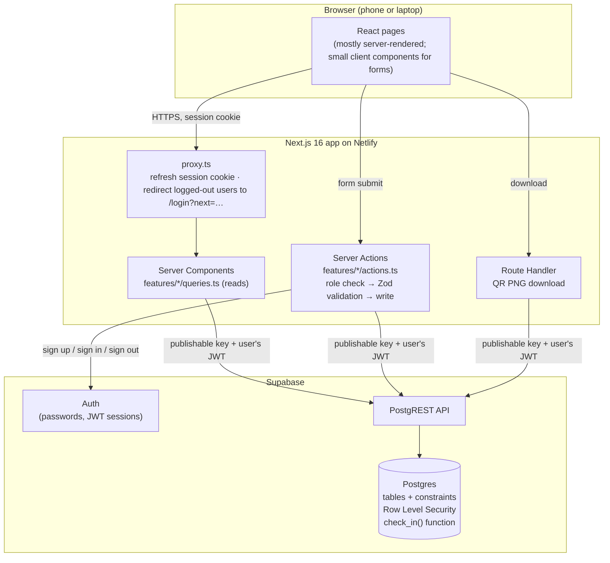

# System architecture

## Overview

## Request flow

1. **Proxy** (`src/proxy.ts`) runs before every page. It refreshes the Supabase session (cookie-based, via `@supabase/ssr`) and sends logged-out visitors on protected pages to `/login?next=<page>`. This is a convenience check, not the security boundary.
2. **Layouts** call `requireRole("student")` or `requireRole("organiser")`. The role is read from the `profiles` table, never from the client. A wrong role is redirected to its own home page.
3. **Pages** (Server Components) read data through `features/*/queries.ts` with a Supabase client that acts as the logged-in user.
4. **Forms** submit to **Server Actions** (`features/*/actions.ts`). Each one checks the role (`assertRole`), validates input with Zod (`features/*/schema.ts`), writes as the logged-in user, and maps database errors to friendly messages.
5. **Postgres** enforces the real rules: RLS policies (which rows), column grants (which columns), constraints (valid values, one check-in/feedback/pulse per student per workshop), and `check_in()` (the only way to create attendance).

## Security model in one paragraph

The app **never uses the Supabase service-role key**. Every query runs with the user's own JWT, so Row Level Security applies to every request; a bug in app code cannot read or change data the user isn't allowed to. New accounts are always students (a database trigger ignores any role in sign-up data). Students can update only their own `full_name`. Organisers are promoted by an admin with a function the API cannot call. Organisers can see student data only for workshops they own. Student IDs are filled in by the database from the session (`default auth.uid()`), and the column cannot be written by the client.

## Layers

| Layer | Location | Responsibility |
|---|---|---|
| Presentation | `src/app/**/page.tsx`, `src/components`, `features/*/*.tsx` | Rendering, accessible forms, empty/loading/error states |
| Validation | `features/*/schema.ts` | Zod schemas shared by Server Actions; unit-tested |
| Business logic | `features/*/actions.ts`, `features/insights/compute.ts`, `features/workshops/schema.ts` | Status transitions, insight aggregation, topic grouping |
| Data access | `features/*/queries.ts`, `lib/supabase/server.ts` | Typed Supabase queries as the logged-in user |
| Auth | `lib/auth.ts`, `proxy.ts`, `lib/supabase/proxy.ts` | Session, current user, role guards, safe redirects |
| Database | `supabase/migrations/*.sql` | Schema, constraints, RLS, functions |

## Key design choices

See [decisions.md](decisions.md). In short: one Next.js app (no separate backend), no service-role key, RLS as the final authority, check-in through one database function, request-time rendering (no page caching of per-user data), minimal dependencies.
