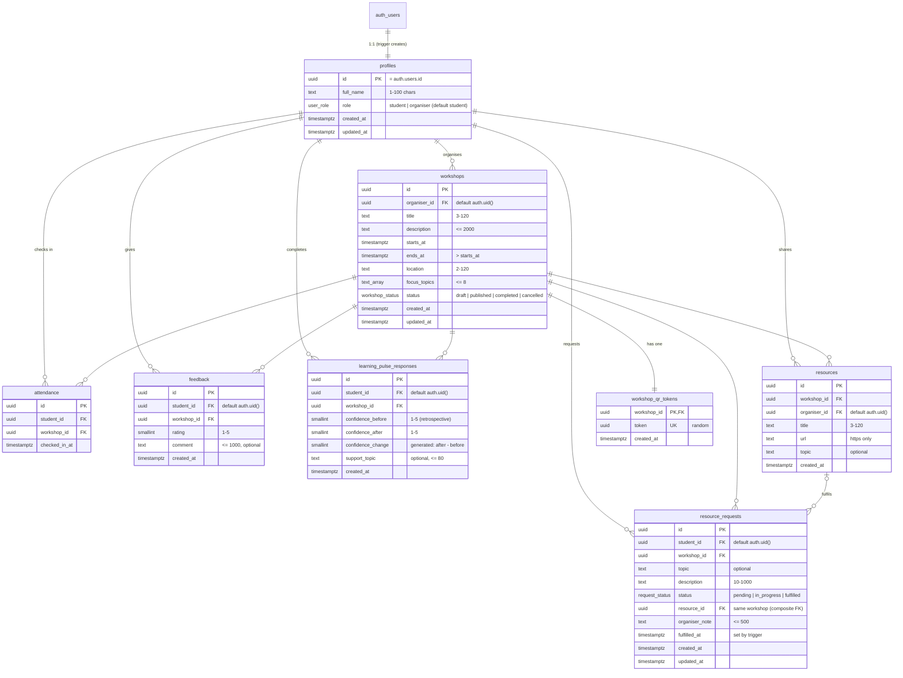

# Database schema

Source of truth: [`supabase/migrations/`](../supabase/migrations/) — `…_schema.sql` (tables, constraints, indexes), `…_functions.sql` (triggers and functions), `…_rls.sql` (grants and Row Level Security).

## Entity Relationship Diagram

## Changes from the coursework's suggested tables

| Addition | Why |
|---|---|
| `workshops.organiser_id` | Ownership: organisers manage, and see student data for, their own workshops only |
| `workshops.ends_at`, `starts_at` (instead of one `date`) | Needed for the check-in window and "happening now" |
| `workshops.focus_topics` | Gives students topic choices, so learning needs group cleanly |
| `workshop_qr_tokens` (instead of `workshops.qr_token`) | Students can read workshops; RLS can't hide one column from them while showing it to organisers |
| `learning_pulse_responses` | The Learning Pulse feature |
| `resources` + `resource_requests.resource_id`, `organiser_note`, `fulfilled_at`, `topic` | Sharing resources and fulfilling requests |

## Constraints and integrity

- **Unique:** one attendance, one feedback and one Learning Pulse per (student, workshop); unique QR token.
- **Checks:** rating and confidence 1–5; `ends_at > starts_at`; text lengths; `https://` URLs; at most 8 focus topics; a fulfilled request must have a resource or a note.
- **Composite FK:** a request can only be fulfilled with a resource from the same workshop.
- **Deletion:** deleting a user cascades to all their records. A workshop with attendance, feedback, pulse or requests cannot be deleted (RESTRICT): organisers cancel instead, and only drafts can be deleted. A resource used to fulfil a request cannot be deleted.
- **Timestamps:** all `timestamptz` (UTC); shown in Europe/London time.
- **Indexes:** on every foreign key used for lookups (`workshop_id`, `student_id`, `organiser_id + starts_at`, `status + starts_at`, `workshop_id + status` for requests).

## Functions and triggers

| Name | Type | Purpose |
|---|---|---|
| `handle_new_user` | trigger on `auth.users` | Creates the profile; role is always `student` |
| `check_in(token)` | SECURITY DEFINER, callable by `authenticated` | The only way to create attendance: validates token, published status, window (30 min before start → 60 min after end), student role; duplicate-safe |
| `promote_to_organiser(email)` | SECURITY DEFINER, **not** callable by `anon`/`authenticated` | Admin-only organiser provisioning from the SQL editor |
| `is_organiser()`, `owns_workshop(id)`, `has_attended(id)` | helpers for RLS policies | Role / ownership / attendance checks |
| `create_workshop_qr_token` | trigger on `workshops` | Every workshop gets a token |
| `set_request_fulfilled_at`, `set_updated_at` | triggers | Timestamp maintenance |

## Who can do what (RLS + column grants)

| Table | Student | Organiser (own workshops only) | Anonymous |
|---|---|---|---|
| profiles | read own; read organisers' names (shown on workshop pages); update own `full_name` only | also read names of students linked to their workshops | — |
| workshops | read non-draft | create, edit, delete drafts; read own drafts | — |
| workshop_qr_tokens | — | read | — |
| attendance | read own; create only via `check_in()` | read | — |
| feedback | create own (attendees only), read own; no edits | read | — |
| learning_pulse_responses | create own (attendees only), read own; no edits | read | — |
| resources | read for non-draft workshops | create, edit, delete | — |
| resource_requests | create own (always `pending`), read own; no edits | read; update `status`, `resource_id`, `organiser_note` only | — |

Every rule above is exercised by `npm run test:db` (see [testing.md](testing.md)).
